# Class Activity 1 — System Calls in Practice

- **Student Name:** [Your Name Here]
- **Student ID:** e20230181
- **Date:** 19 October 2026

**My environment:** Ubuntu VM in VMware Fusion on a Mac (Apple Silicon), Linux 7.0.0-38-generic, aarch64, gcc 15.2.0, strace 6.19.

---

## Warm-Up: Hello System Call

Screenshot of running `hello_syscall.c` on Linux:

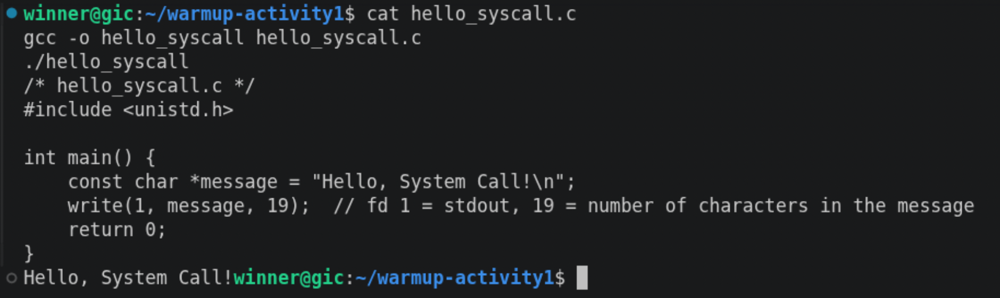

Note: the message is 20 bytes (19 characters + `\n`), but the code writes only 19 bytes, so the `\n` is not printed and my prompt appears on the same line. This shows that `write()` writes exactly the number of bytes we give it.

Screenshot of running `hello_winapi.c` on Windows (CMD/PowerShell/VS Code):

> Not done: I use a Mac, so I cannot run the Windows API program. I asked my instructor about this part.

Screenshot of running `copyfilesyscall.c` on Linux:

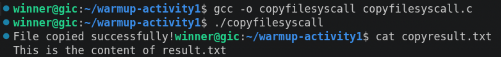

The copy worked: `copyresult.txt` has the same text as `result.txt`. Again the message has no `\n`, because the code writes 25 bytes and "File copied successfully!" is exactly 25 characters.

---

## Task 1: File Creator & Reader

### Part A — File Creator

**Describe your implementation:** In the library version, `fopen()` gives a `FILE *` and the library does the work for me. In the system call version, I use `open()`, which gives an integer file descriptor (3). I must choose the flags and the permissions myself, and I must give the number of bytes to `write()` (I used `strlen()` so the `\n` is included). The terminal output and the content of `output.txt` are the same for both versions. I checked this with `diff`, and the result was `IDENTICAL`.

**Version A — Library Functions (`file_creator_lib.c`):**

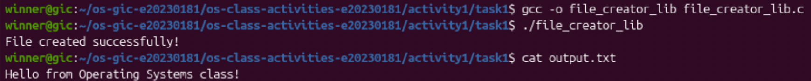

**Version B — POSIX System Calls (`file_creator_sys.c`):**

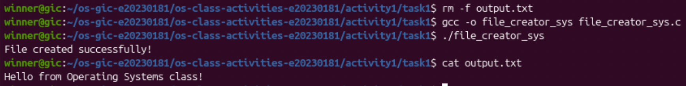

**Questions:**

1. **What flags did you pass to `open()`? What does each flag mean?**

   > I used `O_WRONLY | O_CREAT | O_TRUNC`.
   > - `O_WRONLY`: open the file for writing only.
   > - `O_CREAT`: create the file if it does not exist.
   > - `O_TRUNC`: if the file already exists, delete its old content (size becomes 0).
   >
   > The `|` joins the flags together.

2. **What is `0644`? What does each digit represent?**

   > It is the permission of the new file, written in octal (the first `0` means octal).
   > - `6` = owner can read and write (4 + 2)
   > - `4` = group can only read
   > - `4` = others can only read
   >
   > So the file becomes `-rw-r--r--`.

3. **What does `fopen("output.txt", "w")` do internally that you had to do manually?**

   > With strace I saw that `fopen("w")` calls `openat()` with the same flags `O_WRONLY|O_CREAT|O_TRUNC` and mode `0666`. So `fopen` chooses the flags and the permissions for me. It also creates a `FILE` structure and a buffer in memory (I saw extra `brk` and `fstat` calls). Then `fprintf` puts the text in the buffer, and `fclose` writes the buffer with one `write()` and closes the file. With `open()` I had to do all of this myself: choose the flags, choose the mode, count the bytes, write, and close.
   >
   > Small difference: my umask is `0002`, so the library file gets `0666 - 0002 = 0664`, but my file gets `0644`.

### Part B — File Reader & Display

**Describe your implementation:** I open `output.txt` with `open(..., O_RDONLY)`. Then a `while` loop calls `read()` into a 256-byte buffer and writes exactly `bytesRead` bytes to fd 1 (the screen). The loop stops when `read()` returns 0. I use `bytesRead` and not `strlen()`, because `read()` does not add `\0` at the end. Both versions print the same text (`diff` said `IDENTICAL`).

**Version A — Library Functions (`file_reader_lib.c`):**

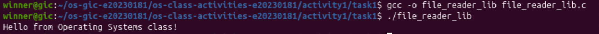

**Version B — POSIX System Calls (`file_reader_sys.c`):**

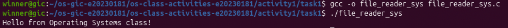

**Questions:**

1. **What does `read()` return? How is this different from `fgets()`?**

   > `read()` returns the number of bytes it really read. It returns `0` at the end of the file and `-1` if there is an error. It does not care about lines, and it does not add `\0`.
   >
   > `fgets()` reads one line (it stops after `\n`), adds `\0` at the end so the buffer is a C string, and returns a pointer (or `NULL` at the end of the file). Also, `fgets` uses the library's own buffer: in strace, the library version called `read(3, ..., 4096)` even though my buffer is 256 bytes.

2. **Why do you need a loop when using `read()`? When does it stop?**

   > `read()` gives at most the number of bytes we ask for (256 here), and it can give fewer. If the file is bigger than the buffer, one call is not enough, so we must call `read()` again and again. The loop stops when `read()` returns `0` (end of file) or `-1` (error). In my strace output: the first `read` returned `36` (the whole file), and the second returned `0`, so the loop stopped.

---

## Task 2: Directory Listing & File Info

**Describe your implementation:** I kept `opendir()`, `readdir()`, `stat()` and `closedir()`. I only changed the output: for each `printf` line, I use `snprintf()` to format the text into a buffer, then `write(1, buffer, strlen(buffer))`. I used exactly the same format strings (`%-30s %10s` and `%-30s %10ld`), so the output is the same (`diff` said `IDENTICAL`). The list includes `.` and `..`, and it is not in alphabetical order, because `readdir()` gives the entries in the order the filesystem stores them.

### Version A — Library Functions (`dir_list_lib.c`)

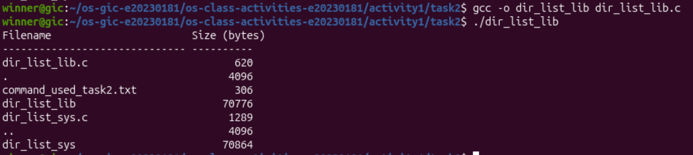

### Version B — System Calls (`dir_list_sys.c`)

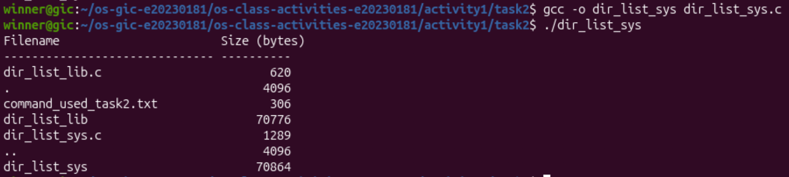

### Questions

1. **What struct does `readdir()` return? What fields does it contain?**

   > It returns a pointer to `struct dirent` (one directory entry). On Linux the fields are:
   > - `d_ino`: inode number of the file
   > - `d_off`: position of the next entry
   > - `d_reclen`: size of this record
   > - `d_type`: type of file (regular file, directory, ...)
   > - `d_name`: the file name (I used this one)

2. **What information does `stat()` provide beyond file size?**

   > `struct stat` also has: the file type and permissions (`st_mode`), the inode number (`st_ino`), the number of hard links (`st_nlink`), the owner user and group (`st_uid`, `st_gid`), the block size and number of blocks (`st_blksize`, `st_blocks`), the device (`st_dev`), and the times of last access, last modification and last status change (`st_atime`, `st_mtime`, `st_ctime`).

3. **Why can't you `write()` a number directly — why do you need `snprintf()` first?**

   > `write()` only copies raw bytes. A number like `620` is stored in memory as a binary value, not as the characters `'6' '2' '0'`. If I write it directly, the screen shows strange symbols. `snprintf()` changes the number into text characters, and it also adds the spaces for the columns. Then `write()` can send this text.

---

## Optional Bonus: Windows API (`file_creator_win.c`)

> Not done: I use a Mac, so I cannot compile and run Windows API programs.

---

## Task 3: strace Analysis

**Describe what you observed:** I was surprised that my system call version also loads `libc.so.6` at startup, because `open()`, `read()`, `write()` and `close()` are small wrapper functions inside libc. Most of the system calls in both programs are this startup work. With the filter `openat,read,write,close`, the two traces are almost the same. The only differences are the mode in `openat` (`0666` for `fopen`, `0644` for my code) and the read size in the reader (`4096` for the library, `256` for my code). The `strace -c` summary shows that the library version makes **4 more** system calls (37 vs 33).

### strace Output — Library Version (File Creator)

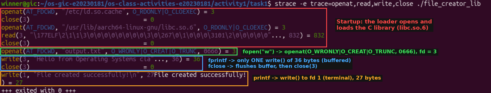

### strace Output — System Call Version (File Creator)

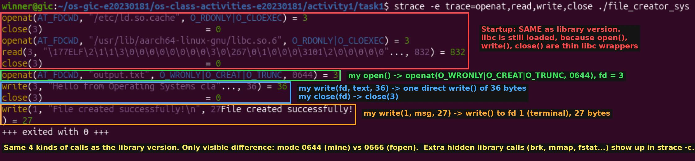

### strace Output — Library Version (File Reader or Dir Listing)

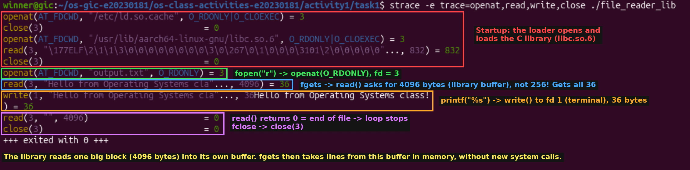

### strace Output — System Call Version (File Reader or Dir Listing)

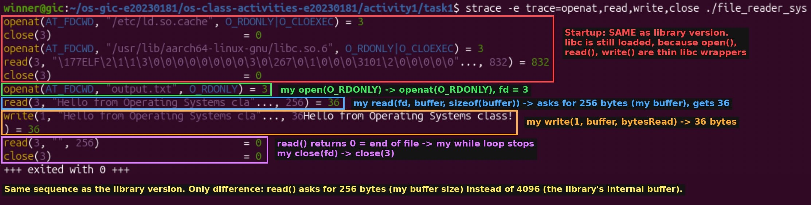

### strace -c Summary Comparison

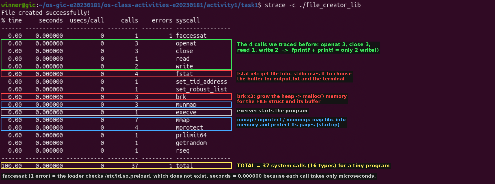
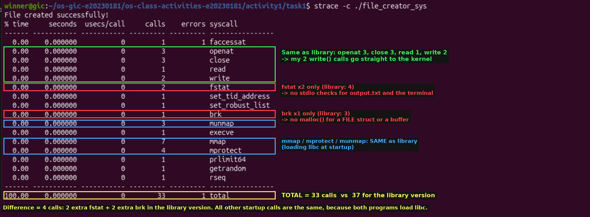

### Questions

1. **How many system calls does the library version make compared to the system call version?**

   > Library version: **37** system calls. System call version: **33** system calls. So the library version makes **4 more**.

2. **What extra system calls appear in the library version? What do they do?**

   > | System call | Library | My version |
   > |---|---|---|
   > | `fstat` | 4 | 2 |
   > | `brk` | 3 | 1 |
   >
   > - `brk`: makes the heap bigger. The library needs heap memory (`malloc`) for the `FILE` structure and its buffer.
   > - `fstat`: gets information about a file (type, block size). The library uses it for `output.txt` and for the terminal, to decide how to buffer the data.
   >
   > The other calls (`mmap`, `mprotect`, `munmap`, `execve`, `openat` of `libc.so.6`, ...) are the same in both versions. They are used to start the program and load libc into memory.

3. **How many `write()` calls does `fprintf()` actually produce?**

   > Only **one**: `write(3, "Hello from Operating Systems cla"..., 36) = 36`. It comes just before `close(3)`, so the text waited in the library buffer and was written when `fclose()` flushed it. This is what I expected after learning about buffering: the library collects the text and sends it with one system call. In total, the program has 2 `write()` calls (one for `fprintf`, one for `printf`), the same as my version.

4. **In your own words, what is the real difference between a library function and a system call?**

   > A library function (like `fopen`, `fprintf`, `printf`) is normal code in libc. It runs in user space and can do extra work like formatting text, using a buffer, and allocating memory. It may make zero, one or many system calls.
   >
   > A system call (like `openat`, `write`, `brk`) is a request to the kernel. The CPU switches to kernel mode, and the kernel does work that a normal program is not allowed to do, like using files or hardware. strace shows only system calls, so it shows what really reaches the kernel.

---

## Task 4: Exploring OS Structure

### System Information

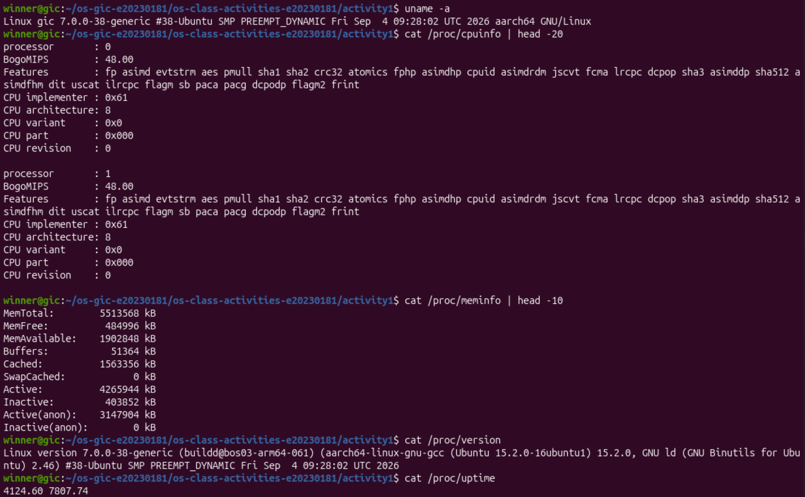

### Process Information

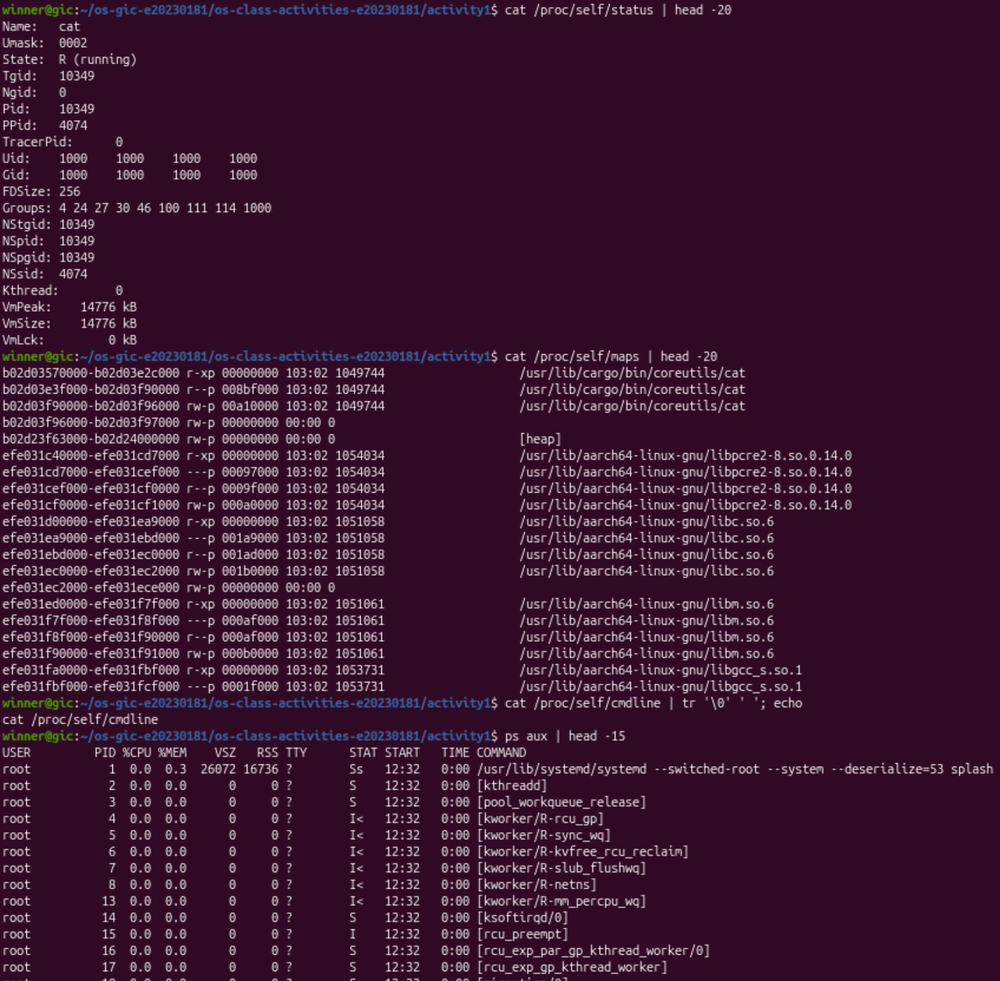

### Kernel Modules

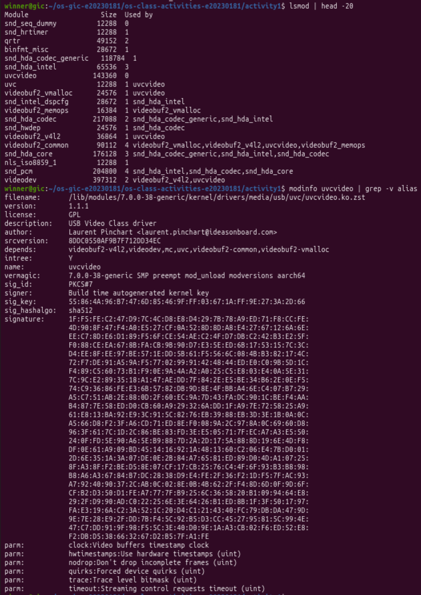

### OS Layers Diagram

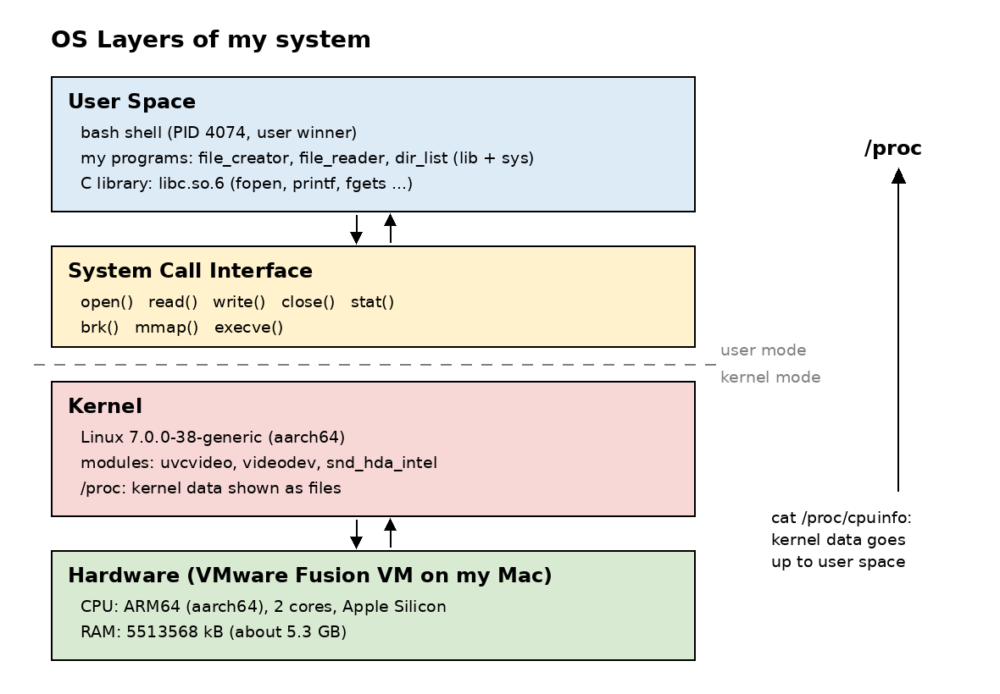

### Questions

1. **What is `/proc`? Is it a real filesystem on disk?**

   > `/proc` is a virtual filesystem. It is not on the disk. When I read a file in `/proc` (for example `cat /proc/meminfo`), the kernel creates the content at that moment from its own data in memory. That is why the numbers change every time (for example `/proc/uptime` was `4013.82` and later `4124.60`).

2. **Monolithic kernel vs. microkernel — which type does Linux use?**

   > In a **monolithic** kernel, almost all OS parts (drivers, filesystems, memory management, scheduler) run together in kernel space. It is fast, but a bug in one driver can crash the whole system. In a **microkernel**, only the most basic parts run in kernel space, and drivers and filesystems run as user processes. It is safer, but slower, because the parts must send messages to each other.
   >
   > Linux is **monolithic**, but **modular**. `lsmod` shows modules like `uvcvideo`, `videodev` and `snd_hda_intel` that are loaded into the running kernel. `modinfo uvcvideo` shows it is a `.ko` file that must match my kernel (`vermagic: 7.0.0-38-generic`). These drivers run inside the kernel, not as separate user programs.

3. **What memory regions do you see in `/proc/self/maps`?**

   > - The program itself (`/usr/lib/cargo/bin/coreutils/cat`): code (`r-xp`), read-only data (`r--p`) and writable data (`rw-p`)
   > - `[heap]`: memory for `malloc()`, the area that `brk` grows
   > - Shared libraries: `libc.so.6`, `libm.so.6`, `libpcre2-8.so`, `libgcc_s.so.1`, each with code, read-only and writable parts
   > - Anonymous regions (no file name), for example zeroed data
   > - The `[stack]` and `[vdso]` are at the end of the file, so they are not in the first 20 lines
   >
   > The letters show the permissions: `r` = read, `w` = write, `x` = execute, `p` = private.

4. **Break down the kernel version string from `uname -a`.**

   > `Linux gic 7.0.0-38-generic #38-Ubuntu SMP PREEMPT_DYNAMIC Fri Sep 4 09:28:02 UTC 2026 aarch64 GNU/Linux`
   >
   > - `Linux`: kernel name
   > - `gic`: hostname of my VM
   > - `7.0.0`: kernel version (major 7, minor 0, patch 0)
   > - `-38`: Ubuntu's build/package number for this kernel
   > - `generic`: Ubuntu's normal kernel flavour
   > - `#38-Ubuntu`: build number
   > - `SMP`: supports many CPU cores (my VM has 2)
   > - `PREEMPT_DYNAMIC`: the preemption mode can be chosen at boot time
   > - `Fri Sep 4 09:28:02 UTC 2026`: date the kernel was built
   > - `aarch64`: CPU architecture (64-bit ARM, Apple Silicon)
   > - `GNU/Linux`: operating system

5. **How does `/proc` show that the OS is an intermediary between programs and hardware?**

   > My programs cannot read the CPU or the RAM directly. But with `cat /proc/cpuinfo` and `cat /proc/meminfo` I can see that my CPU is ARM64 (implementer `0x61` = Apple) and that I have `5513568 kB` of memory. The kernel talks to the hardware, then gives this information to `cat` through normal `openat()` and `read()` system calls. So the program asks the kernel, and the kernel answers about the hardware. The program never touches the hardware itself.

---

## Reflection

> Before this activity, I thought `printf` and `write` were almost the same. Now I know that library functions are a layer on top of system calls. The most surprising thing was `strace -c`: even my "system call" program made 33 system calls, and most of them were only for starting the program and loading libc. The library version made only 4 more. I also saw that `fprintf` does not write immediately: it waits in a buffer and writes everything with one `write()` at `fclose()`. Writing the system call versions taught me to think about small details that the library hides, like flags, permissions, the number of bytes, and `\0` at the end of strings.
