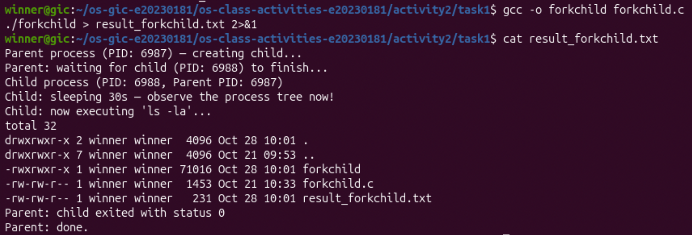
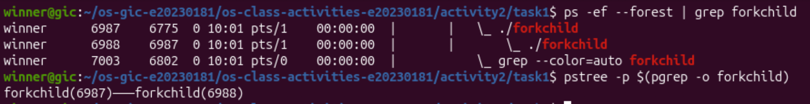
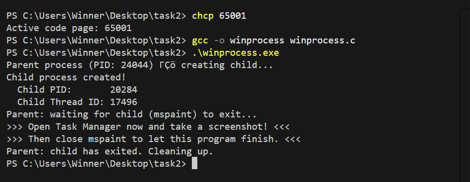
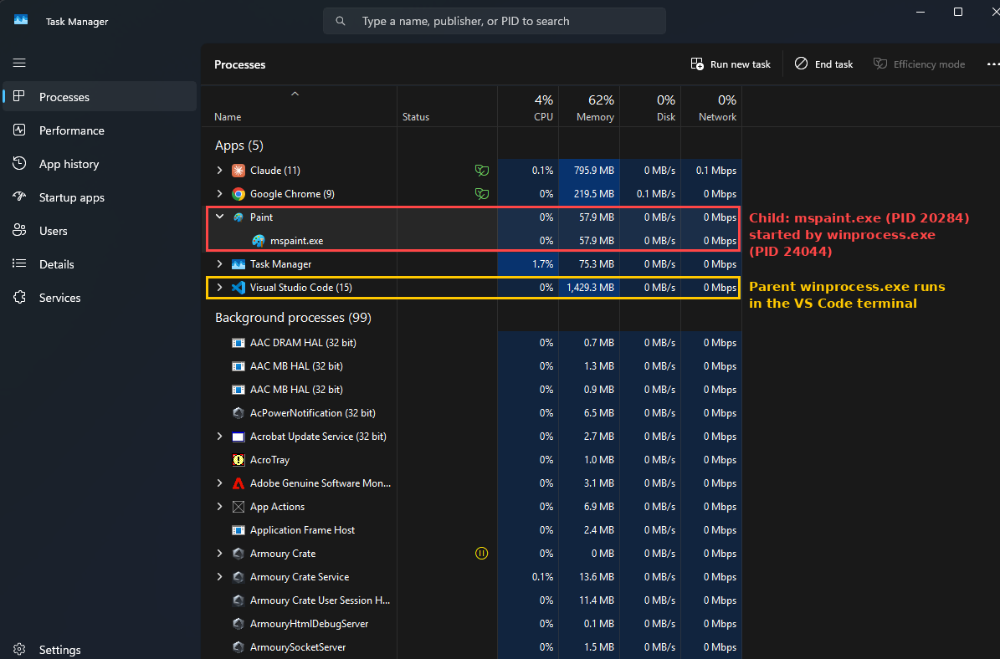
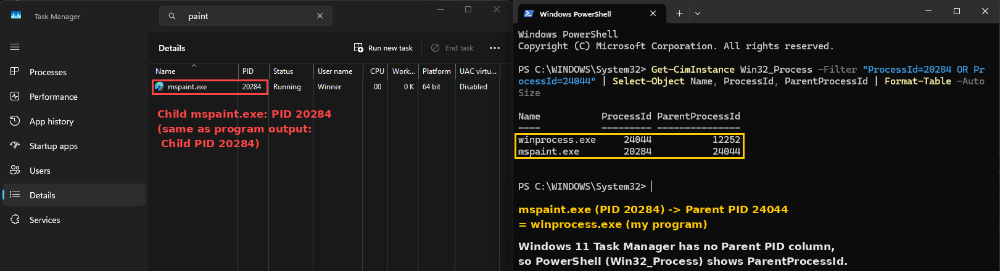
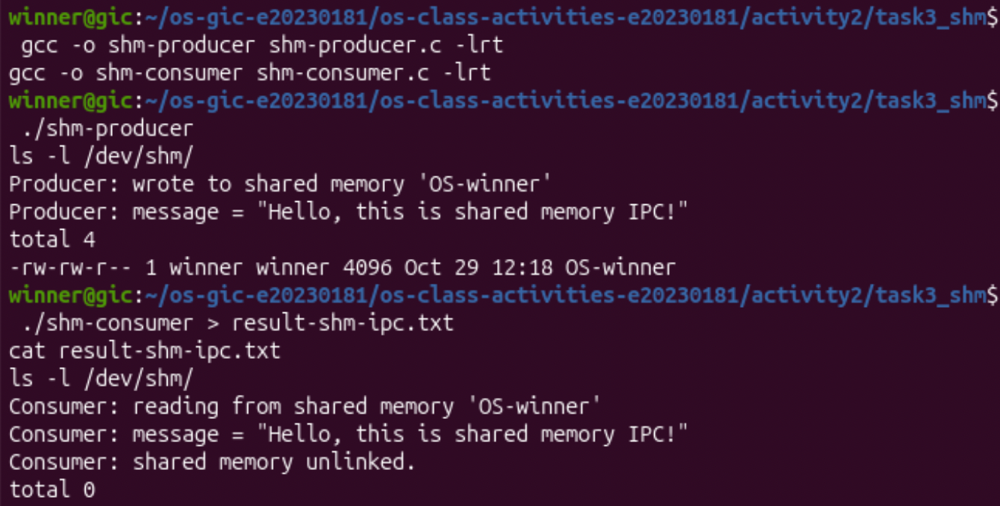
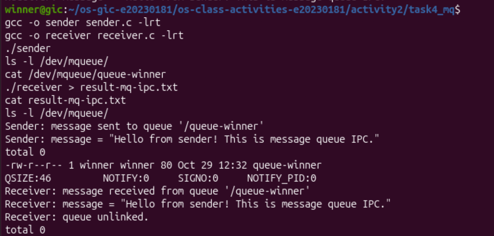

# Class Activity 2 — Processes & Inter-Process Communication

- **Student Name:** THA WINNER
- **Student ID:** e20230181
- **Date:** October 29, 2026

---

## Task 1: Process Creation on Linux (fork + exec)

### Compilation & Execution

Screenshot of compiling and running `forkchild.c`:



### Process Tree

Screenshot of the parent-child process tree (using `ps --forest`, `pstree`, or `htop` tree view):



### Output

```
Parent process (PID: 6987) — creating child...
Parent: waiting for child (PID: 6988) to finish...
Child process (PID: 6988, Parent PID: 6987)
Child: sleeping 30s — observe the process tree now!
Child: now executing 'ls -la'...
total 32
drwxrwxr-x 2 winner winner  4096 Oct 28 10:01 .
drwxrwxr-x 7 winner winner  4096 Oct 21 09:53 ..
-rwxrwxr-x 1 winner winner 71016 Oct 28 10:01 forkchild
-rw-rw-r-- 1 winner winner  1453 Oct 21 10:33 forkchild.c
-rw-rw-r-- 1 winner winner   231 Oct 28 10:01 result_forkchild.txt
Parent: child exited with status 0
Parent: done.
```

Note: I added `fflush(stdout);` before `fork()` and before `execlp()`. When the output goes to a file, `printf` keeps the text in a buffer. `execlp()` replaces the child program, so the buffer is lost. Without `fflush`, the child lines would be missing from `result_forkchild.txt`.

### Questions

1. **What does `fork()` return to the parent? What does it return to the child?**

   > To the parent, `fork()` returns the PID of the new child. In my run the parent got 6988. To the child, it returns 0. If `fork()` fails, it returns -1 to the parent and no child is created. This is how the code knows which part to run (`pid == 0` is the child, `pid > 0` is the parent).

2. **What happens if you remove the `waitpid()` call? Why might the output look different?**

   > The parent does not wait anymore. It prints "Parent: done." and exits right away, and the shell prompt comes back while the child is still sleeping. After 30 seconds the `ls -la` output appears after the prompt, so the output looks mixed. The child becomes an orphan, so its parent changes to `systemd` (or `init`). Also the parent cannot print the child's exit status, and if the parent was still running without waiting, the dead child would stay as a zombie.

3. **What does `execlp()` do? Why don't we see "execlp failed" when it succeeds?**

   > `execlp()` replaces the program in the current process with a new program. It searches the program name in `PATH` (here it finds `ls`) and runs `ls -la`. The PID stays the same (6988), only the code changes. If it works, it never returns, because the old code (with the `perror("execlp")` line) does not exist anymore. We only see the error if `execlp()` fails.

4. **Draw the process tree for your program (parent → child). Include PIDs from your output.**

   > ```
   > bash (PID 6775)
   >  └── forkchild  (PID 6987)   parent, waits in waitpid()
   >       └── forkchild  (PID 6988)   child, PPID = 6987
   >            (after 30 s: execlp() -> becomes "ls -la", same PID 6988)
   > ```

5. **Which command did you use to view the process tree (`ps --forest`, `pstree`, or `htop`)? What information does each column show?**

   > I used `ps -ef --forest | grep forkchild` and `pstree -p`. In `ps -ef` the columns are: UID (user who owns the process, `winner`), PID (process ID), PPID (parent process ID), C (CPU use), STIME (start time), TTY (terminal, `pts/1`), TIME (CPU time used), and CMD (the command). With `--forest`, the child is shown under the parent with `\_`. In my screenshot, PID 6988 has PPID 6987. `pstree -p` shows it in one line: `forkchild(6987)───forkchild(6988)`.

---

## Task 2: Process Creation on Windows

### Compilation & Execution

Screenshot of compiling and running `winprocess.c`:



Note: My first run failed with `CreateProcess failed (error 2)`. Error 2 means "file not found". On my Windows 11 PC, Paint is not in `C:\Windows\System32\mspaint.exe` because the new Paint is a Store app. So I changed the code: the first parameter of `CreateProcess()` is `NULL` and the command line is `"mspaint.exe"` (in a `char` array). Then Windows searches for mspaint by itself, and it worked. The `ΓÇö` in the screenshot is only the `—` character shown with the wrong encoding in the terminal.

### Task Manager Screenshots

Screenshot showing process tree in the **Processes** tab (mspaint nested under your program):



Note: Windows 11 shows Paint as its own app group in the Processes tab, so it does not appear under Visual Studio Code. The Details screenshot below proves the parent-child link with PIDs.

Screenshot showing PID and Parent PID in the **Details** tab:



Note: Task Manager on my Windows 11 has no Parent PID column, so I used PowerShell next to it:
`Get-CimInstance Win32_Process -Filter "ProcessId=20284 OR ProcessId=24044" | Select-Object Name, ProcessId, ParentProcessId`

### Questions

1. **What is the key difference between how Linux creates a process (`fork` + `exec`) and how Windows does it (`CreateProcess`)?**

   > Linux uses two steps. `fork()` makes a copy of the parent, then `exec()` loads a new program into the child. Between the two steps, the child can still run the parent's code. Windows uses one step: `CreateProcess()` makes a new process and loads the new program at the same time. It also needs many parameters (path, command line, security, startup info, etc.), while `fork()` needs none.

2. **What does `WaitForSingleObject()` do? What is its Linux equivalent?**

   > It blocks the parent until the object (here the child process handle `pi.hProcess`) is finished. With `INFINITE`, it waits with no time limit. In my run, the parent stayed on "waiting for child" until I closed Paint. The Linux equivalent is `waitpid()` (or `wait()`).

3. **Why do we need to call `CloseHandle()` at the end? What happens if we don't?**

   > `CreateProcess()` gives us two handles (`hProcess` and `hThread`). They are references to kernel objects. `CloseHandle()` gives them back to Windows. If we don't close them, it is a handle leak: Windows keeps the process and thread objects in memory even after the child ended, until our program exits. In a long-running program this wastes resources.

4. **In Task Manager, what was the PID of your parent program and the PID of mspaint? Do they match your program's output?**

   > My program printed parent PID 24044, child PID 20284 and child thread ID 17496. In the Details tab, `mspaint.exe` has PID 20284, the same as the output. In PowerShell, `mspaint.exe` (20284) has Parent PID 24044, which is `winprocess.exe`. And `winprocess.exe` has parent 12252, the PowerShell inside VS Code. So yes, they match.

5. **Compare the Processes tab (tree view) and the Details tab (PID/PPID columns). Which view makes it easier to understand the parent-child relationship? Why?**

   > The Processes tab is easy to read, but it groups processes by app, not by real parent. On my PC, Paint was shown as its own app and not under VS Code, so it did not show the real relationship. The PID and Parent PID numbers are better, because they show exactly which process started which one. In my case I needed PowerShell for the Parent PID, because Task Manager has no such column.

---

## Task 3: Shared Memory IPC

### Compilation & Execution

Screenshot of compiling and running `shm-producer` and `shm-consumer`:



### Output

```
Consumer: reading from shared memory 'OS-winner'
Consumer: message = "Hello, this is shared memory IPC!"
Consumer: shared memory unlinked.
```

### Questions

1. **What does `shm_open()` do? How is it different from `open()`?**

   > `shm_open()` creates or opens a POSIX shared memory object by name and returns a file descriptor. The object is in memory, not on the disk. On Linux it appears in `/dev/shm/` (I saw `OS-winner` with size 4096 there). `open()` opens a normal file with a path on the file system, and the data is saved on disk. Also, a new shared memory object has size 0, so we must use `ftruncate()` to give it a size.

2. **What does `mmap()` do? Why is shared memory faster than other IPC methods?**

   > `mmap()` maps the shared memory object into the address space of the process and returns a pointer. After that, the program reads and writes it like a normal array. The producer and the consumer use the same physical memory. It is faster because after the setup there are no system calls and no copying through the kernel for each message. Pipes and message queues need the kernel to copy the data every time.

3. **Why must the shared memory name match between producer and consumer?**

   > The name is how the two processes find the same object. The producer creates `OS-winner`, and the consumer must open `OS-winner`. If the names are different, the consumer looks for an object that does not exist and gets an error (or, with another name, it could read someone else's memory). This is also why the name should be unique to each student.

4. **What does `shm_unlink()` do? What would happen if the consumer didn't call it?**

   > `shm_unlink()` removes the name of the shared memory object. The memory is freed when no process uses it anymore. In my screenshot, `/dev/shm/` showed `OS-winner` after the producer and `total 0` after the consumer. If the consumer didn't call it, `OS-winner` would stay in `/dev/shm/` and use memory until reboot or until someone deletes it by hand.

5. **If the consumer runs before the producer, what happens? Try it and describe the error.**

   > I ran `./shm-consumer` again after the object was deleted. It printed `shm_open: No such file or directory` and `Hint: Did you run shm-producer first?`, and the exit code was 1. The consumer opens with `O_RDONLY` only (no `O_CREAT`), so it cannot create the object. It can only open an existing one.

---

## Task 4: Message Queue IPC

### Compilation & Execution

Screenshot of compiling and running `sender` and `receiver`:



### Output

```
Receiver: message received from queue '/queue-winner'
Receiver: message = "Hello from sender! This is message queue IPC."
Receiver: queue unlinked.
```

### Questions

1. **How is a message queue different from shared memory? When would you use one over the other?**

   > With shared memory, both processes read and write the same memory directly, and they must handle synchronization themselves. With a message queue, the kernel keeps the messages and copies them. Each message is separate, they come out in order (by priority), and `mq_receive()` waits if the queue is empty. In my test, the message stayed in the queue (QSIZE:46) after the sender exited. I would use shared memory for big data or when speed is important, and a message queue for small messages or commands where order and simple use are more important.

2. **Why does the queue name in `common.h` need to start with `/`?**

   > POSIX says a message queue name must start with `/` followed by a name with no other `/`. On Linux, `mq_open()` gives an error (`EINVAL`) if the name doesn't start with `/`. The `/` does not mean a real folder. The queue appears as `/dev/mqueue/queue-winner`.

3. **What does `mq_unlink()` do? What happens if neither the sender nor receiver calls it?**

   > `mq_unlink()` removes the queue name. The queue is deleted when all processes have closed it. If nobody calls it, the queue stays in the kernel (in `/dev/mqueue/`) with any unread messages, until reboot or until someone deletes it. The next time the sender runs, it opens the old queue and adds to the old messages.

4. **What happens if you run the receiver before the sender?**

   > I ran `./receiver` when the queue did not exist. It printed `mq_open: No such file or directory` and `Hint: Did you run sender first?`, with exit code 1. The receiver opens with `O_RDONLY` only, so it cannot create the queue. (If the queue existed but was empty, `mq_receive()` would block and wait for a message, because the queue is in blocking mode.)

5. **Can multiple senders send to the same queue? Can multiple receivers read from the same queue?**

   > Yes, many senders can open the same queue and send messages, until the queue is full (`mq_maxmsg` is 10 here). Many receivers can also read from the same queue, but each message is given to only one receiver: the first one that calls `mq_receive()`. It is not a broadcast. In this program, the receiver also calls `mq_unlink()`, so the other receivers would fail after the first one.

---

## Reflection

What did you learn from this activity? What was the most interesting difference between Linux and Windows process creation? Which IPC method do you prefer and why?

> I learned how a process creates a child and how two processes can share data. The most interesting difference for me was that Linux uses two steps (`fork` then `exec`) and Windows uses one call (`CreateProcess`) with many parameters. I also had real problems that taught me something: the child output was missing from the file until I used `fflush()`, and on Windows 11 Paint was not at the path in the sheet (error 2) and Task Manager did not show it under my program, so I used PIDs to prove the parent-child link. For IPC, I prefer the message queue for simple programs, because the kernel keeps the message and the receiver gets the whole message in order. But shared memory is better when the data is big and speed matters.
