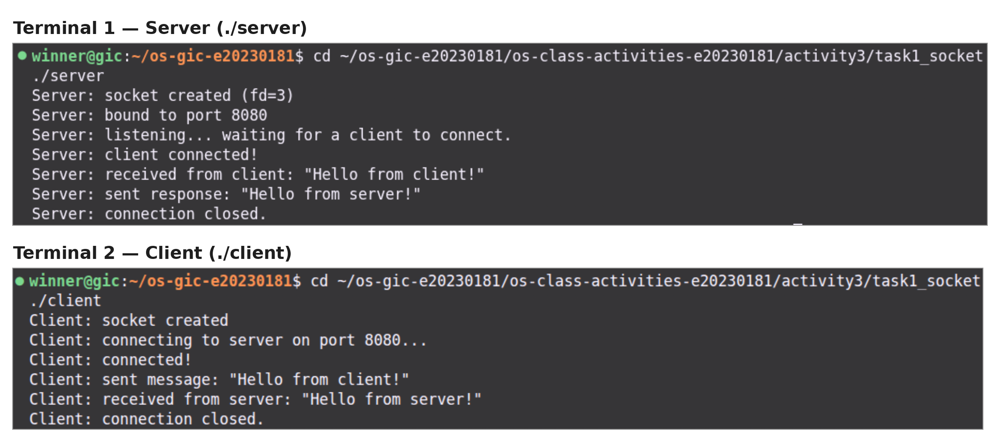
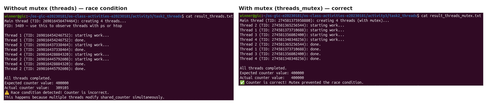
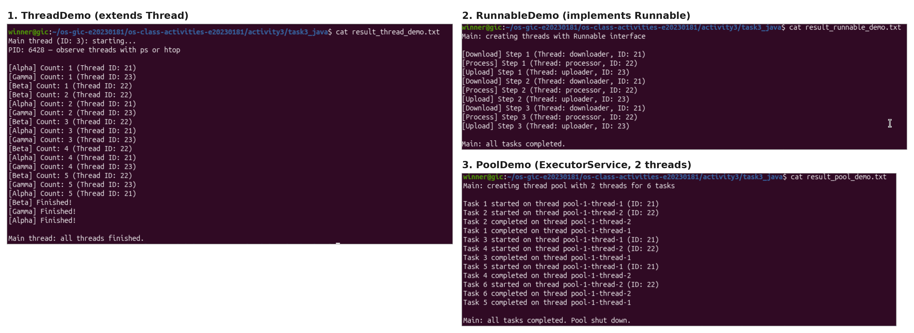
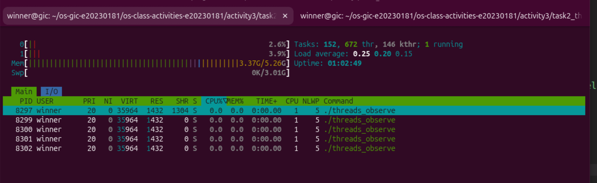
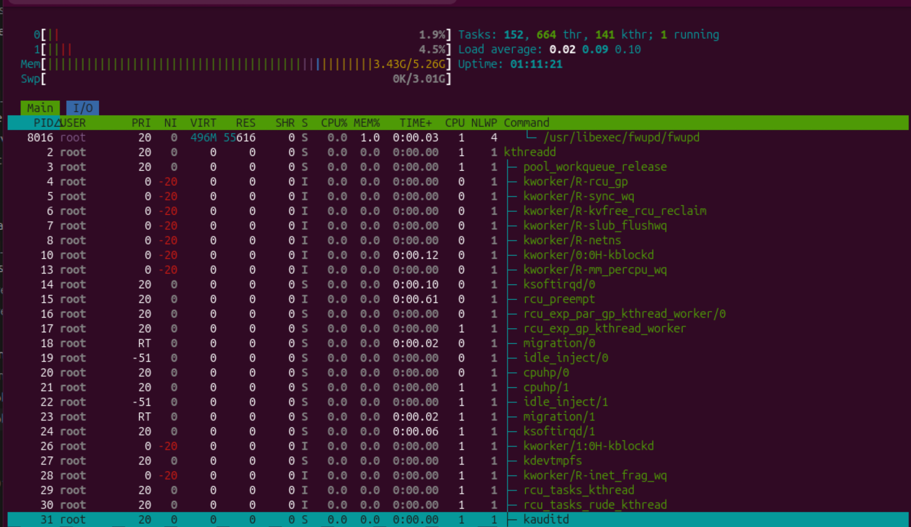
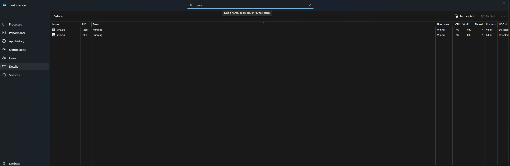

# Class Activity 3 — Socket Communication & Multithreading

- **Student Name:** THA WINNER
- **Student ID:** e20230181
- **Date:** 15 November 2026

---

## Task 1: TCP Socket Communication (C)

### Compilation & Execution



### Answers

1. **Role of `bind()` / Why client doesn't call it:**
   > `bind()` gives the server socket a fixed address: all network interfaces (`INADDR_ANY`) and port 8080. Clients must know where to find the server, so the server needs a known port. The client does not call `bind()` because nobody needs to find the client. When it calls `connect()`, the OS gives it a free temporary port automatically.

2. **What `accept()` returns:**
   > `accept()` waits until a client connects, then returns a new socket file descriptor (`client_fd`). This new socket is only for talking with that one client (`read()` and `send()`). The original `server_fd` (fd=3 in my output) is not used for data. It only keeps listening for new clients.

3. **Starting client before server:**
   > I ran `./client` when no server was running. The output was:
   > ```
   > Client: socket created
   > Client: connecting to server on port 8080...
   > connect: Connection refused
   > ```
   > No program was listening on port 8080, so the OS refused the connection, `connect()` failed, and the client stopped.

4. **What `htons()` does:**
   > `htons()` means "host to network short". It changes the port number (a 16-bit number) from the computer's byte order to network byte order (big-endian). My VM is ARM64 (aarch64), which is little-endian, so 8080 is stored with the bytes in the opposite order. All computers on a network must read the port the same way, so we convert it before putting it in the address.

5. **Socket call sequence diagram:**
   > ```
   >        SERVER                               CLIENT
   >        ------                               ------
   >        socket()                             socket()
   >           |                                    |
   >        bind()  (port 8080)                     |
   >           |                                    |
   >        listen()                                |
   >           |                                    |
   >        accept()  <------ TCP handshake ---- connect()
   >        (waits)                                 |
   >           |                                    |
   >        read()    <-- "Hello from client!" -- send()
   >           |                                    |
   >        send()    --- "Hello from server!" -> read()
   >           |                                    |
   >        close()                              close()
   > ```

---

## Task 2: POSIX Threads (C)

### Output — Without Mutex (Race Condition)



### Output — With Mutex (Correct)

_(Included in the same screenshot: race condition on the left, mutex version on the right.)_

My VM has 2 CPU cores (`nproc` = 2). I ran `./threads` several times and got: 400000, 340933, 400000 and 309105. The saved run (`result_threads.txt`, PID 5489) gave **309105**, so 90,895 increments were lost. With the mutex, every run (4 times) gave exactly **400000**.

### Answers

1. **What is a race condition?**
   > A race condition happens when two or more threads use the same data at the same time, and the result depends on which thread runs first. `shared_counter++` looks like one step, but the CPU does 3 steps: read the value, add 1, write it back. If two threads read the same value at the same time, both write the same new value, so one +1 is lost. In my runs the result was sometimes correct (400000) and sometimes wrong (340933, 309105). In the correct runs, each thread finished before the next one started, so they did not overlap. In the wrong runs, threads started at the same time on my 2 cores.

2. **What does `pthread_mutex_lock()` do?**
   > It takes the lock (the mutex). If another thread already has it, the thread waits until it is free. So only one thread at a time can run `shared_counter++` (the critical section), and the read, add and write steps cannot mix. After the increment, `pthread_mutex_unlock()` gives the lock back. In `result_threads_mutex.txt` all 4 threads started before any finished, so they really ran together, but the counter was still exactly 400000.

3. **Removing `pthread_join()`:**
   > I tested a copy of `threads.c` without `pthread_join()` (in `/tmp`, not in my repo). Main did not wait for the threads.
   > - Run 1 (PID 6123): only Thread 1 printed "starting" and never printed "done". Threads 2, 3 and 4 printed nothing. The counter was **66019**. When `main` returned, the whole process ended and killed the threads.
   > - Run 2 (PID 6128): main printed "All threads completed." before any thread started. Only threads 1 and 3 had finished when main read the counter, so it showed **200000**.
   >
   > So without `pthread_join()`, main reads the result too early, and threads can be killed before they finish.

4. **Thread vs Process:**
   > A process is a running program with its own address space. A thread is a smaller unit of execution inside a process. Creating a thread is cheaper than creating a process with `fork()`, and threads can share data easily.
   > - **Shared by all threads:** code, global data (like `shared_counter`), heap, open files, signals, and the PID.
   > - **Private to each thread:** its own stack (local variables like `id` and `i`), its own registers and program counter, and its own thread ID (TID).

---

## Task 3: Java Multithreading

### ThreadDemo Output



### RunnableDemo Output

_(Included in the same screenshot, part 2.)_

### PoolDemo Output

_(Included in the same screenshot, part 3.)_

In ThreadDemo (PID 6428), the main thread had ID 3, and Alpha, Beta and Gamma had IDs 21, 22 and 23. The order changed every round (for example Alpha, Gamma, Beta, then Beta, Alpha, Gamma), because the OS decides which thread runs after each `sleep(500)`. In PoolDemo, all 6 tasks ran on only 2 threads: `pool-1-thread-1` (ID 21) and `pool-1-thread-2` (ID 22).

### Answers

1. **Thread vs Runnable:**
   > With `extends Thread`, the class itself is a thread, and the work and the thread are mixed together. With `implements Runnable`, the class is only a task (the work), and I give it to a `Thread` object (the worker), like `new Thread(new PrintTask("Download"), "downloader")`. Java allows only one parent class, so a `Runnable` class can still extend another class. I prefer `Runnable` in most cases, because the same task can also be given to a thread pool. `extends Thread` is OK for small, simple programs.

2. **Pool size limiting concurrency:**
   > `Executors.newFixedThreadPool(2)` creates only 2 worker threads. The 6 tasks wait in a queue, and each worker takes the next task only when it is free. In my output, tasks ran in pairs (1 and 2, then 3 and 4, then 5 and 6), only on `pool-1-thread-1` and `pool-1-thread-2`. Task 5 started on thread-1 right after Task 3 completed, even before Task 4 was done. The whole program took about 3 seconds (6 tasks / 2 threads x 1 second).

3. **thread.join() in Java:**
   > `join()` makes the main thread wait until that thread is finished. I tested `ThreadDemo` without the 3 `join()` calls (a copy in `/tmp`, PID 7051). Main printed "Main thread: all threads finished." after only 2 count lines (Alpha 1 and Beta 1), so the message was wrong. But all 15 count lines and all 3 "Finished!" lines still appeared, because the JVM waits for all normal threads before it exits. This is different from C, where the threads were killed when `main` ended.

4. **ExecutorService advantages:**
   > - It reuses a fixed number of threads, so it does not create and destroy a new thread for every task (that is slow and uses memory).
   > - It limits how many threads run at the same time, so a big application does not create thousands of threads.
   > - It has a task queue, so we just `submit()` tasks and do not manage threads by hand.
   > - It has easy shutdown and waiting (`shutdown()` and `awaitTermination()`).

---

## Task 4: Observing Threads

### Linux — `ps -eLf` Output

From `result_observe_linux.txt` (PID 7648):

```
UID          PID    PPID     LWP  C NLWP STIME TTY          TIME CMD
winner      7648    6369    7648  0    5 14:12 pts/3    00:00:00 ./threads_observe
winner      7648    6369    7650  0    5 14:12 pts/3    00:00:00 ./threads_observe
winner      7648    6369    7651  0    5 14:12 pts/3    00:00:00 ./threads_observe
winner      7648    6369    7652  0    5 14:12 pts/3    00:00:00 ./threads_observe
winner      7648    6369    7653  0    5 14:12 pts/3    00:00:00 ./threads_observe
winner      7660    6369    7660  0    1 14:12 pts/3    00:00:00 grep --color=auto threads_observe
```

The last line is only the `grep` command itself, because it also contains the word "threads_observe".

### Linux — htop Thread View



### Linux — htop Kernel Threads (tree view, `kthreadd`)



### Linux — Kernel Threads (commands)

Output of commands (1) and (3) (PID 8749):

```
$ ps -L -o pid,lwp,nlwp,psr,stat,comm -p $PID
    PID     LWP NLWP PSR STAT COMMAND
   8749    8749    5   0 Sl   threads_observe
   8749    8751    5   0 Sl   threads_observe
   8749    8752    5   1 Sl   threads_observe
   8749    8753    5   1 Sl   threads_observe
   8749    8754    5   1 Sl   threads_observe

$ ps -o pid,ppid,psr,comm -p 2
    PID    PPID PSR COMMAND
      2       0   1 kthreadd

$ ps --ppid 2 -o pid,ppid,psr,comm | head -15
    PID    PPID PSR COMMAND
      3       2   1 pool_workqueue_release
      4       2   0 kworker/R-rcu_gp
      5       2   0 kworker/R-sync_wq
      6       2   0 kworker/R-kvfree_rcu_reclaim
      7       2   0 kworker/R-slub_flushwq
      8       2   0 kworker/R-netns
     10       2   0 kworker/0:0H-kblockd
     13       2   0 kworker/R-mm_percpu_wq
     14       2   0 ksoftirqd/0
     15       2   1 rcu_preempt
     16       2   0 rcu_exp_par_gp_kthread_worker/0
     17       2   0 rcu_exp_gp_kthread_worker
     18       2   0 migration/0
     19       2   0 idle_inject/0
```

### Windows — Task Manager



I use a Mac, so I ran `ThreadDemo` on a Windows PC with Java 25 (with `Thread.sleep(5000)`, as the sheet suggests, to have more time). In the Details tab, my `java.exe` (PID 7908) had **25 threads**. The other `java.exe` (PID 12368, 4 threads) was another Java program on that PC.

### Answers

1. **LWP column meaning:**
   > LWP means "Light Weight Process". It is the thread ID that the kernel gives to each thread. In my output, all 5 rows have the same PID (7648), but each row has a different LWP (7648, 7650, 7651, 7652, 7653). So one LWP is one thread. On Linux, every thread made with `pthread_create()` is a real kernel task with its own LWP.

2. **/proc/PID/task/ count:**
   > I found **5** entries in `/proc/7648/task/`: 7648, 7650, 7651, 7652 and 7653. Yes, it matches my program: 4 worker threads + 1 main thread = 5. The folder names are the same numbers as the LWP column.

3. **Extra Java threads:**
   > My `java.exe` showed 25 threads, but I created only 3 (Alpha, Beta, Gamma). With the main thread that is 4, so about 21 threads come from the JVM itself. These are JVM system threads, for example: garbage collector (GC) threads, JIT compiler threads (C1/C2 CompilerThread), Reference Handler, Finalizer, Signal Dispatcher, Common-Cleaner and Attach Listener. My thread IDs also showed this: on Linux, Alpha, Beta and Gamma got IDs 21, 22 and 23, because the lower IDs were already used by JVM threads.

4. **Linux vs Windows thread viewing:**
   > Windows Task Manager (Details tab) only shows the number of threads for each process (25 for `java.exe`). Linux shows each thread as its own row: `ps -eLf`, `ps -L` and `/proc/<PID>/task/` give me every thread ID (LWP), the thread count (NLWP), the CPU core (PSR) and the state (STAT), and I can save it as text. `htop` also shows each thread live. So Linux gives more detail. On Windows I would need an extra tool like `jstack` or Process Explorer to see each thread.

5. **kthreadd and three kernel threads:**
   > `kthreadd` is the kernel thread that creates and manages the other kernel threads. Its PID is **2**, and its parent is PID 0 (the kernel itself starts it, not systemd). Three kernel threads I found: `ksoftirqd/0` (PID 14), `rcu_preempt` (PID 15) and `migration/0` (PID 18). I can tell they are kernel threads because their parent (PPID) is 2 (`kthreadd`), they belong to `root`, and in htop their memory (VIRT, RES, SHR) is 0, because kernel threads have no user address space. Some also come once per CPU core, like `ksoftirqd/0` and `ksoftirqd/1`, and `migration/0` and `migration/1`, because my VM has 2 cores. The htop header showed about 142 kernel threads (`kthr`). My Ubuntu VM did not hide them.

6. **TID equal to PID, NLWP and cores:**
   > The **main thread** has a thread ID equal to the PID: in `ps -L`, LWP 8749 = PID 8749, and in htop, 8297 = PID 8297. **NLWP is 5** on every row (1 main + 4 workers). In `ps -L` the threads were on cores (PSR) 0, 0, 1, 1, 1, so both cores were used. In `result_observe_linux.txt` they were on 0, 1, 1, 0, 1. In my htop screenshot all 5 threads showed CPU 1 at that moment. The threads only sleep, so they stay on the core where they last ran.

7. **`H` and `K` in htop:**
   > `H` shows or hides the user threads of each process. Without `H`, I would see only 1 row for `threads_observe`, not the 5 threads. `K` shows or hides the kernel threads. Without `K`, I would not see `kthreadd` and its children (`kworker`, `ksoftirqd`, `rcu_preempt`, `migration`...), even though they are always running.

---

## Reflection

> The most interesting part for me was the race condition. The same program gave 400000 one time and 309105 another time, with no change in the code. It only depended on how the OS scheduled the threads on my 2 cores. This showed me that a bug in concurrent code can hide, because a program can look correct in one test and be wrong in the next. Adding a mutex fixed it every time. I also liked seeing that sockets let two separate processes talk, even on the same machine.
>
> Looking at threads with `ps`, `/proc` and `htop` helped me understand that a thread is a real thing for the kernel: each one has its own ID, state and CPU core, and the kernel also runs many threads of its own. Knowing this helps me write better concurrent programs: I should protect shared data, always wait for threads with `join()`, and not create too many threads (a thread pool is better), because every thread costs the OS something to schedule.