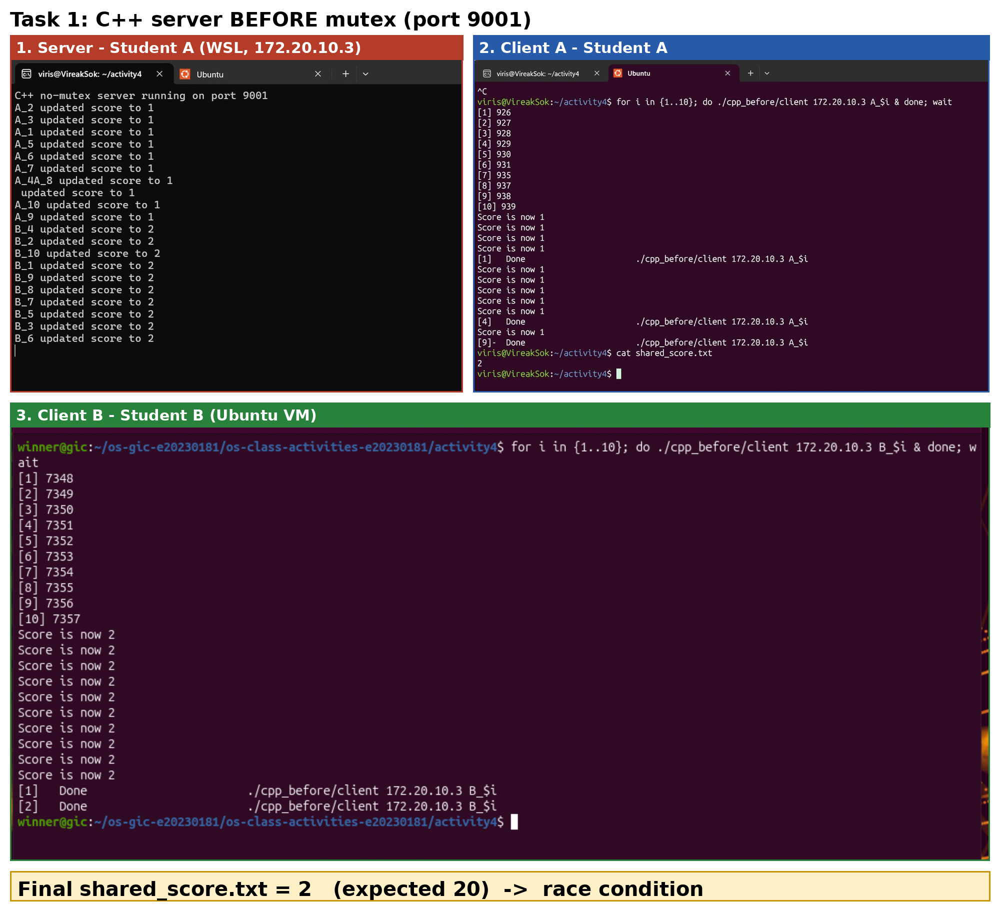
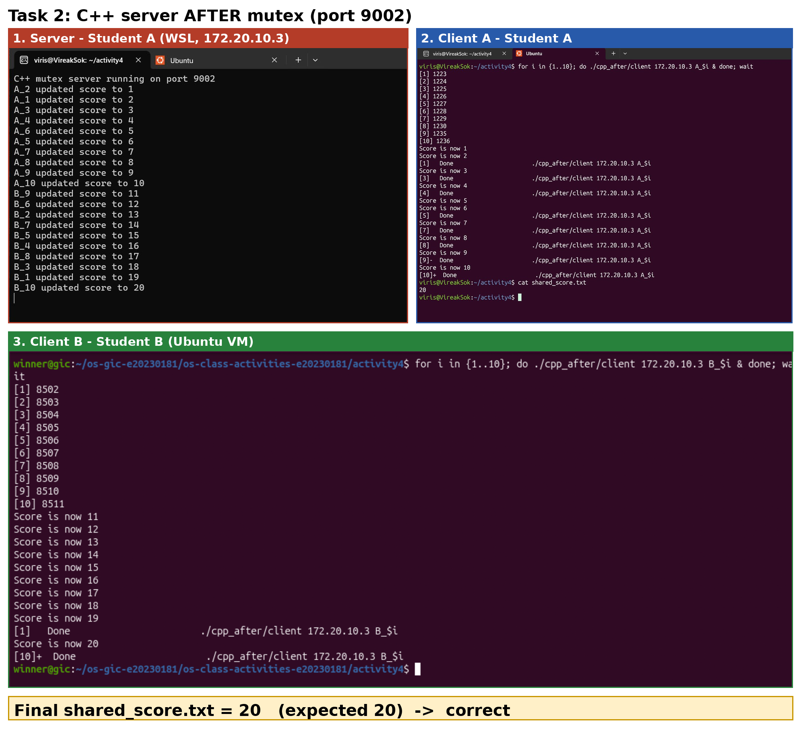
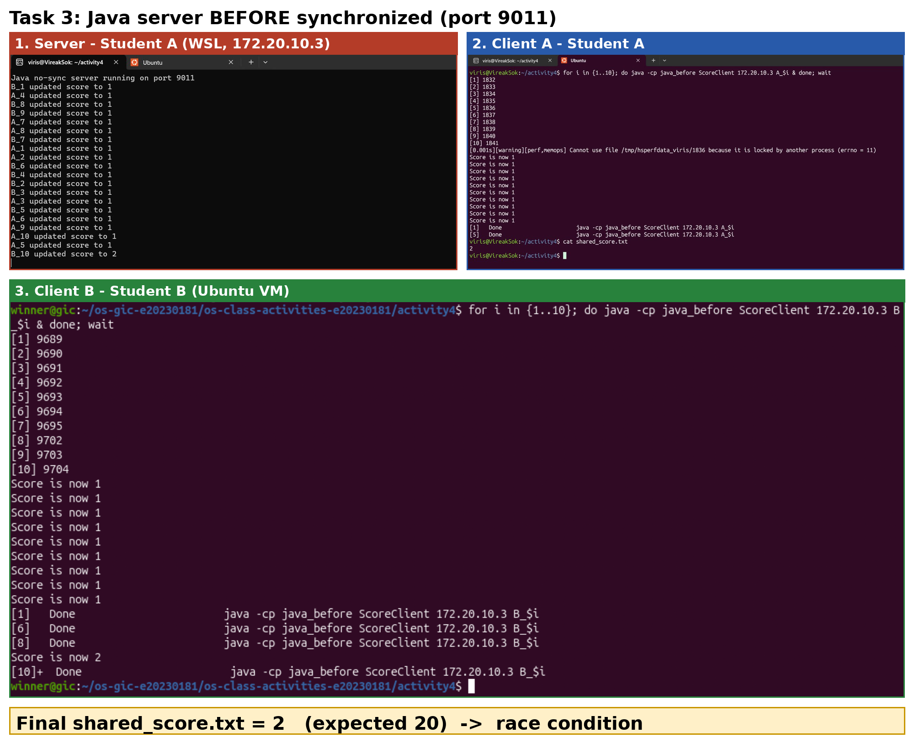
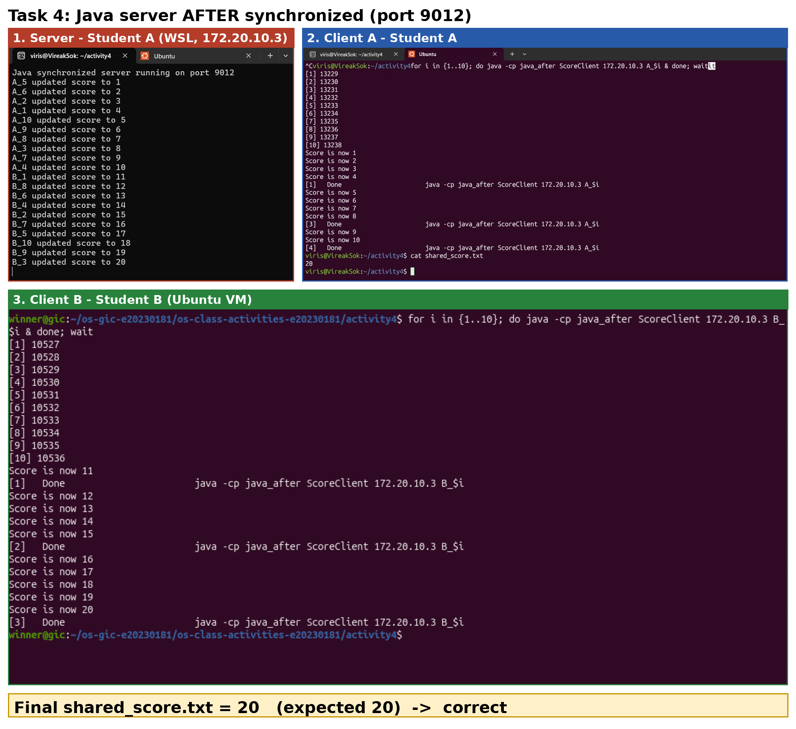

# Class Activity 4 — Shared File API

- **Student Name:** THA WINNER
- **Student ID:** e20230181
- **Date:** 2026-11-20
- **Partner Name:** SOK VIREAK
- **Partner Student ID:** e20231270
- **Server Machine Owner:** viris@VireakSok (Student A, Windows with WSL Ubuntu)
- **Server IP Address:** 172.20.10.3

Setup: My partner (Student A) ran the server and Client A on his Windows laptop in WSL Ubuntu. I (Student B) ran Client B from my Ubuntu VM. Both machines were on the same phone hotspot. Each student sent 10 requests at the same time, so the server got 20 requests in total.

---

## Task 1: C++ Before Mutex

- Expected score after 20 total client requests: 20
- Actual score: 2
- What happened: 18 updates were lost. All 10 requests from Student A got "Score is now 1" and all 10 requests from Student B got "Score is now 2". Each server thread reads the file, sleeps 200 ms, then writes. During the sleep, the other threads also read the same old value, so they all wrote the same number. In the server output we can also see `A_4A_8 updated score to 1`, which shows two threads printing at the same time.

---

## Task 2: C++ After Mutex

- Expected score after 20 total client requests: 20
- Actual score: 20
- What changed after adding mutex: The server output now goes 1, 2, 3 ... 20, and every number appears only once. Client A got 1 to 10 and Client B got 11 to 20. The mutex lets only one thread do read → sleep → +1 → write at a time, so no update is lost. The test took a few seconds longer because the requests now wait for each other.

---

## Task 3: Java Before Synchronized

- Expected score after 20 total client requests: 20
- Actual score: 2
- What happened: The same race condition as in C++. 19 of the 20 requests wrote "updated score to 1", and only B_10 wrote 2. In the server output, A and B requests are mixed (B_1, A_4, B_8, ...), so the requests from both machines really ran at the same time. They all read 0 during the 200 ms sleep and overwrote each other. 18 updates were lost.

---

## Task 4: Java After Synchronized

- Expected score after 20 total client requests: 20
- Actual score: 20
- What changed after adding synchronized: The server output goes from 1 to 20 with no repeated number. Client A got 1 to 10 and Client B got 11 to 20. Only the word `synchronized` was added to `updateScore()`, and now only one thread can run that method at a time.

---

## Questions

1. **Why should clients send requests to the server instead of writing the file directly?**
   If every client writes the file by itself, many programs on different machines touch the same file and we cannot control them. With a server, only one program touches the file. The clients only send a request like `B_3`, and the server decides how to update the file. So there is one place where we can protect the file and check the requests.

2. **Why does the server still have a race condition before mutex or synchronized?**
   The server creates one new thread for each client. All these threads run `update_score()` / `updateScore()` at the same time. Each thread reads the score, sleeps 200 ms, adds 1 and writes. If two threads read before the other one writes, they read the same value and one update is lost. In our test, 20 requests gave only 2 in both C++ and Java.

3. **In the C++ fixed version, what does `std::lock_guard<std::mutex>` protect?**
   It protects the whole body of `update_score()`: reading `shared_score.txt`, the sleep, `score++`, writing the file and printing the message. The lock is taken when `lock_guard` is created and is released automatically when the function ends. Because `file_mutex` is global, all client threads use the same lock.

4. **In the Java fixed version, what does `synchronized` protect?**
   It protects the whole `updateScore()` method: reading the file, the sleep, `score++` and writing the file. Because the method is `static synchronized`, all threads use one lock (the `ScoreServerSync` class), so only one thread can be inside the method at a time. Java releases the lock automatically when the method ends, even if there is an error.

5. **Why is the final score expected to be 20 when Student A sends 10 requests and Student B sends 10 requests?**
   The score starts at 0 and each request adds exactly 1. 10 + 10 = 20 requests, so 0 + 20 = 20. If the result is less than 20, some updates were lost because of the race condition.

6. **What could happen if two separate servers update the same file at the same time?**
   The race condition comes back. A mutex or `synchronized` only works inside one program. Two servers are two different processes with two different locks, so they cannot see each other's lock. Both servers could read the same value and overwrite each other, and the final score would be less than expected again. To fix it, they would need a lock that works between processes (for example a file lock), or only one server should own the file.

---

## Reflection

C++ and Java solved the same problem in a similar way. In C++ I had to create a `std::mutex` myself and use `std::lock_guard` to lock it. In Java I only added one word, `synchronized`, and Java used a built-in lock for me. Both versions unlock automatically when the function ends, so I don't forget to unlock. In both languages, the result went from 2 to 20 after adding the lock, and the requests became a little slower because they had to wait.

This activity taught me that having one server is not enough to protect a shared resource. The server still uses many threads, so the part that reads and writes the file (the critical section) must be locked. I also saw that the race condition is real across two machines: the requests from my VM and my partner's laptop were mixed together and lost 18 of 20 updates. The lock should cover the whole read → change → write step, not only the write.
