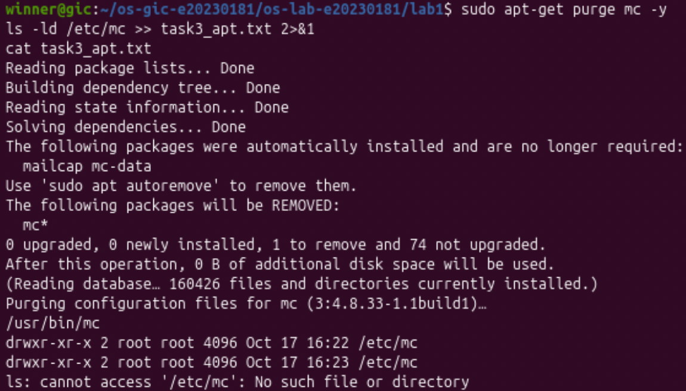
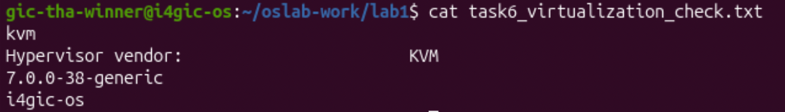
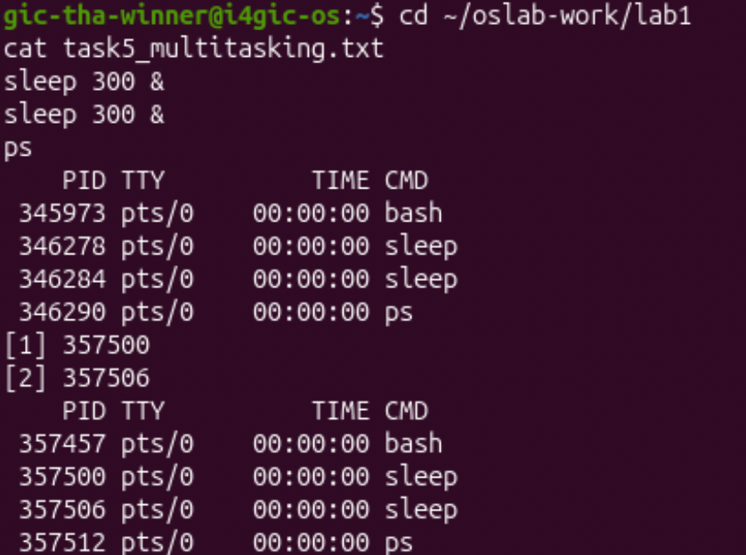

# OS Lab 1 Submission

- **Student Name:** THA WINNER
- **Student ID:** e20230181
- **Ubuntu username on the server:** gic-tha-winner
- **My values** (`oslab values lab1`): file1 = market, file2 = stone, count = 2

---

## Task 1: Operating System Identification

The server runs Linux with kernel version **7.0.0-38-generic** (from `uname -a`). The distribution is **Ubuntu 26.04.1 LTS**, codename "resolute" (from `lsb_release -a`). The kernel version is the number from `uname`; it belongs to the core of the system that controls the hardware. The distribution version is the number from `lsb_release`; it belongs to Ubuntu, which is the kernel plus many other programs.

```text
Linux i4gic-os 7.0.0-38-generic #38-Ubuntu SMP PREEMPT_DYNAMIC Fri Sep  4 09:10:14 UTC 2026 x86_64 GNU/Linux
Distributor ID: Ubuntu
Description:    Ubuntu 26.04.1 LTS
Release:        26.04
Codename:       resolute
```

---

## Task 2: Essential Linux File and Directory Commands

I made the folder `task2_files` with `mkdir` and went into it with `cd`. I created `market.txt` and `stone.txt` with `touch` and wrote one line into each with `echo`. Then I copied `market.txt` with `cp`, renamed `stone.txt` to `stone_renamed.txt` with `mv`, and deleted the copy with `rm`. After each step I saved the `ls` output in `task2_file_commands.txt`, using `>>` to add to the file. The last `ls` showed `market.txt` and `stone_renamed.txt`. I also learned that `../` is needed to save the record in the folder above, because without the `/` a hidden file was created by mistake.

---

## Task 3: Package Management Using APT

I installed `mc` and checked the folder `/etc/mc` after each step:

| Step | Result for `/etc/mc` |
|---|---|
| After `install` | the folder exists, and the program is at `/usr/bin/mc` |
| After `remove` | the folder **still exists** |
| After `purge` | `No such file or directory` |

`remove` uninstalled the program but kept its settings in `/etc/mc`. `purge` uninstalled the program and also deleted its settings. APT showed `Purging configuration files for mc` during the purge.



---

## Task 4: Programs vs Processes

`which sleep` showed that the program is the file `/usr/bin/sleep`. I ran `sleep 30 &`, where `&` runs it in the background and gives the prompt back. Then `ps` showed `sleep` in the process list with its own PID (346042). When I ran it a second time, it got a new PID (346064).

- **Before:** the program existed as a file, `/usr/bin/sleep`.
- **During:** `ps` showed a `sleep` process with a PID.
- **After 30 seconds:** the process was gone from `ps`, but `which sleep` still showed `/usr/bin/sleep`.

A **program** is a file stored on the disk. A **process** is a program that is running; it exists only while it runs and has its own PID. One program can become many processes.

---

## Task 5: Multitasking

My count was 2, so I started `sleep 300 &` two times. `ps` showed **2 `sleep` lines** (PID 346278 and 346284), together with `bash` and `ps`. This shows that the operating system can keep several processes running at the same time.

It does **not** show how the processor is shared. `sleep` only waits and uses no processor time, so we cannot see how the system switches the processor between processes that really compute.



---

## Task 6: Virtualization and Hypervisor Detection

| Command | Output |
|---|---|
| `systemd-detect-virt` | `kvm` |
| `lscpu \| grep -i "hypervisor vendor"` | `Hypervisor vendor: KVM` |
| `uname -r` | `7.0.0-38-generic` |
| `hostname` | `i4gic-os` |

The server runs on a **virtual machine**, not on physical hardware. `systemd-detect-virt` printed `kvm` (not `none`), and `lscpu` confirmed that the hypervisor vendor is KVM.



---

## My Prediction: Confirmed or Corrected

Not done.

---

## Plus / Challenge (only if you did them)

Not done.

## AI Note (optional)

